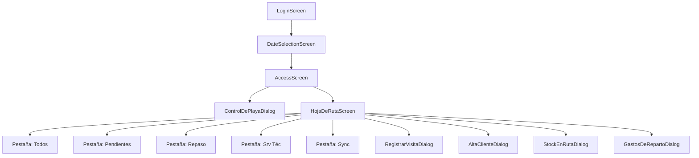
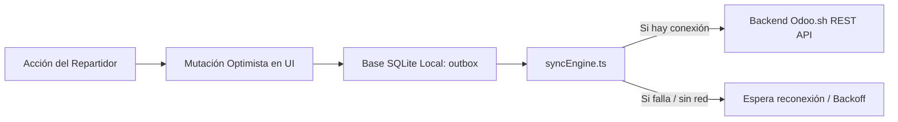

# Insa Reparto — Aplicación Móvil (React Native / Expo)

Aplicación móvil interna para repartidores y transportistas de **Insa** (gestión de logística, distribución y reparto). Proporciona control de inventario de camión en playa (*Control de Playa*), gestión dinámica de la hoja de ruta diaria (*Hoja de Ruta*), registro de visitas y ventas en ruta (con/sin transacción, cobros y envases), alta rápida de clientes y sincronización bidireccional *offline-first* con **Odoo 18** (`insa_reparto`).

---

## 📑 Tabla de Contenidos
1. [Características Principales](#-características-principales)
2. [Stack Tecnológico](#-stack-tecnológico)
3. [Arquitectura del Proyecto](#-arquitectura-del-proyecto)
4. [Estructura Modular de Archivos](#-estructura-modular-de-archivos)
5. [Autenticación y Sesión](#-autenticación-y-sesión)
6. [Flujo de Hoja de Ruta y Operaciones](#-flujo-de-hoja-de-ruta-y-operaciones)
7. [Modo Offline & SQLite Mirror](#-modo-offline--sqlite-mirror)
8. [Integración con Backend Odoo (`insa_reparto`)](#-integración-con-backend-odoo-insa_reparto)
9. [Librería de Componentes](#-librería-de-componentes)
10. [Pantallas y Diálogos](#-pantallas-y-diálogos)
11. [Instalación y Configuración](#-instalación-y-configuración)
12. [Guía de Contribución y Buenas Prácticas](#-guía-de-contribución-y-buenas-prácticas)

---

## 🚀 Características Principales

- **Gestión de Hoja de Ruta Diaria**:
  - Pestañas organizadas: **Todos**, **Pendientes** (estricto sin movimiento), **Repaso** (ausentes o reprogramados), **Srv Téc** (mantenimiento de dispensers frío/calor) y **Sync** (panel offline).
  - Modalidades de vista: *Interactiva* (con acciones rápidas) y *Solo Lectura* (preventivo ante toques accidentales).
  - Búsqueda universal instantánea con normalización de acentos y discriminación visual (*En ruta* vs *Fuera de ruta*).
  - Reordenamiento visual de paradas en ruta mediante modal interactivo.
  - Quitar cliente de la ruta con confirmación estándar y soporte offline.
  - Agregar clientes fuera de ruta a la jornada actual con reflejo en Odoo y SQLite local.
- **Registro de Visitas y Ventas (Punta a Punta)**:
  - Modo **Con transacción**: venta de artículos retornables/descartables, control de stock disponible en camión, gestión de envases (entregados, retirados, fallados) y múltiples medios de pago (Efectivo, Transferencia, Cheque, Cuenta Corriente).
  - Modo **Sin transacción**: registro de visitas no exitosas (Ausente, No Compró, Cerrado, Ya Atendido).
  - Indicador dinámico del estado de gestión (`check-circle` al registrar con éxito).
- **Control de Playa (Salida y Entrada)**:
  - Registro de odómetro (kilometraje) con cálculo de distancia recorrida.
  - Verificación y carga de productos y envases en el camión.
  - Aprobación por segundo factor (supervisor de playa).
- **Alta Rápida de Clientes en Ruta**:
  - Detección de duplicados en tiempo real.
  - Selección de días y frecuencias de visita.
  - Encadenamiento directo al registro de visita con reasignación automática de IDs temporales.
- **Control de Stock y Gastos en Ruta**:
  - Consulta de stock a bordo (Llenos, Vacíos, Fallados, Total Envases).
  - Declaración y cómputo de gastos operativos en ruta.
- **Arquitectura Offline-First con Espejo SQLite**:
  - Base de datos local SQLite (`insa_reparto.db`) que actúa como espejo de Odoo.sh.
  - Cola de operaciones en outbox con reintento exponencial, resolución de dependencias y mutaciones optimistas.

---

## 🛠 Stack Tecnológico

| Área | Tecnología | Propósito |
|---|---|---|
| **Framework Base** | **Expo SDK 57**, React Native 0.86, React 19, TypeScript | Entorno de desarrollo móvil multiplataforma |
| **Navegación** | `@react-navigation/native-stack` v7 | Gestión de pila de pantallas y parámetros de ruta |
| **Estado Remoto** | `@tanstack/react-query` v5 | Cacheo de consultas, invalidación y refetching |
| **Persistencia de Caché** | `@tanstack/query-async-storage-persister` + `expo-sqlite/kv-store` | Caché en disco de datos maestros para uso sin conexión |
| **Base de Datos Local** | `expo-sqlite` (v2 migrations) | Espejo local de hoja de ruta, outbox offline y marcas de clientes |
| **Almacenamiento Seguro** | `expo-secure-store` | Persistencia encriptada de credenciales y tokens JWT de sesión |
| **Conectividad** | `@react-native-community/netinfo` | Detección en tiempo real de conexión a Internet y auto-sincronización |
| **Diseño y Tipografía** | `@expo-google-fonts/source-sans-3`, `@expo/vector-icons` | Sistema de diseño unificado, tokens y MaterialIcons |
| **Áreas Seguras** | `react-native-safe-area-context` | Adaptación a muescas (*notches*) y barras de navegación nativas |

---

## 📂 Arquitectura del Proyecto

```
app_movil_reparto_rn/
├── assets/                    # Íconos, splash y logotipo oficial Insa
├── designs/                   # Diseños de referencia (Google Stitch / Figma)
├── src/
│   ├── api/                   # Clientes HTTP y contratos REST de Odoo
│   │   ├── odooClient.ts      # Cliente JSON-RPC genérico (execute_kw)
│   │   ├── repartoApiClient.ts# Cliente REST especializado para insa_reparto
│   │   ├── types.ts           # Modelos de datos de sesión y endpoints Odoo
│   │   └── normalize.ts       # Normalización de many2one y fechas UTC
│   ├── auth/                  # Contexto y proveedor de autenticación
│   │   └── AuthContext.tsx    # Hook useAuth() y restauración de sesión
│   ├── components/            # Librería de 25 componentes visuales modulares
│   ├── config/                # Configuración de entorno (URLs, Odoo DB)
│   ├── db/                    # Persistencia local SQLite y migraciones
│   │   ├── database.ts        # Inicialización de insa_reparto.db
│   │   ├── outbox.ts          # CRUD de la cola de sincronización offline
│   │   └── clientMarks.ts     # CRUD de marcas locales (Repaso / Srv Téc)
│   ├── hooks/                 # Custom hooks (Auth, Hoja de Ruta, Catálogos, Stock)
│   ├── navigation/            # RootNavigator y StackParamList
│   ├── screens/               # 11 Pantallas y Diálogos modulares
│   ├── sync/                  # Motor de sincronización offline y conectividad
│   │   ├── syncEngine.ts      # Replay del outbox con reintento y remap de IDs
│   │   ├── queuedWrites.ts    # Punto de entrada para mutaciones optimistas
│   │   ├── SyncProvider.tsx   # Contexto global de estado de sincronización
│   │   └── connectivity.ts    # Observador de red NetInfo
│   └── theme/
│       └── tokens.ts          # Tokens globales (colores, espaciados, tipografías)
├── App.tsx                    # Punto de entrada de la aplicación
└── package.json
```

---

## 📦 Estructura Modular de Archivos

Para garantizar un código limpio, desacoplado y mantenible tanto por desarrolladores humanos como por agentes de IA, **cada componente y pantalla reside en su propio directorio con 5 archivos esenciales**:

```
NombreModulo/
├── index.tsx       # Core del componente / pantalla (renderizado y ciclo de vida)
├── types.ts        # Interfaces, tipos de Props, estados y modelos de datos
├── styles.ts       # Definición de StyleSheet y estilos visuales encapsulados
├── utils.ts        # Funciones auxiliares, validaciones, transformadores y helpers
└── README.md       # Documentación técnica completa del módulo
```

### Barriles de Exportación
Todos los componentes y pantallas se exportan a través de sus respectivos archivos barril:
- [`src/components/index.ts`](file:///E:/2026/Odoo_Projects/app_movil_reparto_rn/src/components/index.ts)
- [`src/screens/index.ts`](file:///E:/2026/Odoo_Projects/app_movil_reparto_rn/src/screens/index.ts)

---

## 🔐 Autenticación y Sesión

La app autentica contra el modelo Odoo `insa.repartidor.credencial` vinculado a una ruta (`fsm.route`):

- **Login**: `POST /insa/api/login` con credenciales de vehículo (ej: `reparto01@insareparto.local` / `insa2026`).
- **Token JWT**: Retorna un token `Bearer` almacenado de forma segura mediante `expo-secure-store`.
- **Restauración Silenciosa**: Al iniciar la app, `AuthContext` valida el token mediante `GET /insa/api/whoami`. Si la sesión es válida, navega directamente a `DateSelectionScreen`.

---

## 🚛 Flujo de Hoja de Ruta y Operaciones



### Pestañas de la Hoja de Ruta:
1. **Todos**: Listado completo de paradas asignadas en la jornada. Soporta ordenamiento manual, búsqueda universal (En ruta / Fuera de ruta), y alternancia entre vista interactiva y solo lectura.
2. **Pendientes**: Muestra exclusivamente clientes sin ningún tipo de gestión previa (`!visitado && resultado === null && cobroEfectivo === 0 && !iconosVisita`). Siempre en modo solo lectura.
3. **Repaso**: Clientes ausentes o marcados localmente para re-visita en la jornada.
4. **Srv Téc**: Clientes marcados para atención técnica de dispensers.
5. **Sync**: Panel de control del motor offline, con métricas de sincronización, reintentos y descarte de operaciones.

---

## 📶 Modo Offline & SQLite Mirror

La aplicación está diseñada bajo el paradigma **Offline-First**. El repartidor puede operar con normalidad en zonas sin cobertura celular.



### Mecanismos Clave:
1. **IDs Temporales Negativos**: Al dar de alta un cliente sin conexión, se le asigna un ID negativo (`-Date.now()`). Las visitas posteriores se enlazan mediante `depends_on`. Al recuperar la conexión, el motor sincroniza el alta, obtiene el `partner_id` real de Odoo y reasigna automáticamente las visitas encoladas.
2. **Espejo SQLite Local**: Las consultas de catálogos (ciudades, listas de precios, productos) y la hoja de ruta se conservan en SQLite para consulta inmediata sin red.
3. **Eliminación y Adición Offline**: Quitar o agregar clientes a la ruta se aplica inmediatamente en local y se sincroniza con el backend cuando hay conectividad.

---

## 🔌 Integración con Backend Odoo (`insa_reparto`)

| Endpoint | Método | Descripción | Soporte Offline |
|---|---|---|---|
| `/insa/api/login` | `POST` | Autenticación de repartidor por credencial | Requiere conexión |
| `/insa/api/whoami` | `GET` | Verificación de token y datos de la ruta | Caché local |
| `/insa/api/hoja-de-ruta` | `GET` | Obtención de la hoja de ruta del día | Caché / SQLite |
| `/insa/api/clientes/buscar` | `GET` | Búsqueda global de clientes | Remoto + fallback local |
| `/insa/api/hoja-de-ruta/agregar-cliente` | `POST` | Agregar cliente fuera de ruta a la jornada | Encolado en Outbox |
| `/insa/api/hoja-de-ruta/quitar-cliente` | `POST` | Quitar cliente de la hoja de ruta | Encolado en Outbox |
| `/insa/api/visita` | `POST` | Registrar visita (venta, cobro, envases, no-venta) | Encolado en Outbox |
| `/insa/api/control-playa` | `POST` | Guardar inventario de salida/entrada | Encolado en Outbox |
| `/insa/api/clientes` | `POST` | Alta rápida de cliente | Encolado en Outbox |
| `/insa/api/gastos-reparto` | `POST` | Declarar gasto operativo en ruta | Encolado en Outbox |
| `/insa/api/stock-en-ruta` | `GET` | Stock a bordo en tiempo real | En desarrollo |

---

## 🧩 Librería de Componentes

Todos los componentes reutilizables se ubican en [`src/components/`](file:///E:/2026/Odoo_Projects/app_movil_reparto_rn/src/components) con tipado estricto y sin dependencias cruzadas indebidas:

- [**`Badge`**](file:///E:/2026/Odoo_Projects/app_movil_reparto_rn/src/components/Badge/README.md): Etiquetas de estado (*sm* / *md*).
- [**`BottomNavBar`**](file:///E:/2026/Odoo_Projects/app_movil_reparto_rn/src/components/BottomNavBar/README.md): Barra inferior de 5 pestañas con puntos de notificación.
- [**`BrandMark`**](file:///E:/2026/Odoo_Projects/app_movil_reparto_rn/src/components/BrandMark/README.md): Isotipo/logotipo institucional de Insa.
- [**`Button`**](file:///E:/2026/Odoo_Projects/app_movil_reparto_rn/src/components/Button/README.md): Botón multifunción (primary, secondary, success, neutral) con loaders y variantes de radio.
- [**`Card`**](file:///E:/2026/Odoo_Projects/app_movil_reparto_rn/src/components/Card/README.md): Contenedor de superficie con bordes y acentos de color.
- [**`CardActionBar`** / **`CardActionButton`**](file:///E:/2026/Odoo_Projects/app_movil_reparto_rn/src/components/CardActionBar/README.md): Barra de acciones rápidas para tarjetas de clientes (Ir / Repaso / Gestiones).
- [**`Dialog`**](file:///E:/2026/Odoo_Projects/app_movil_reparto_rn/src/components/Dialog/README.md): Modal estándar flotante con fondo atenuado.
- [**`DrawerMenu`** / **`NavigationDrawer`**](file:///E:/2026/Odoo_Projects/app_movil_reparto_rn/src/components/DrawerMenu/README.md): Menú lateral de operaciones y pie de usuario.
- [**`EmptyState`**](file:///E:/2026/Odoo_Projects/app_movil_reparto_rn/src/components/EmptyState/README.md): Indicador visual para listas vacías o filtros sin resultados.
- [**`ErrorState`**](file:///E:/2026/Odoo_Projects/app_movil_reparto_rn/src/components/ErrorState/README.md): Mensaje de error con botón de reintento.
- [**`FeedbackDialog`**](file:///E:/2026/Odoo_Projects/app_movil_reparto_rn/src/components/FeedbackDialog/README.md): Diálogo modal interactivo para confirmaciones, advertencias y éxito.
- [**`FloatingActionButton`**](file:///E:/2026/Odoo_Projects/app_movil_reparto_rn/src/components/FloatingActionButton/README.md): Botón flotante para acciones principales.
- [**`IconButton`**](file:///E:/2026/Odoo_Projects/app_movil_reparto_rn/src/components/IconButton/README.md): Botón de ícono táctil.
- [**`ListItem`**](file:///E:/2026/Odoo_Projects/app_movil_reparto_rn/src/components/ListItem/README.md): Fila interactiva para listas y menús.
- [**`LoadingState`**](file:///E:/2026/Odoo_Projects/app_movil_reparto_rn/src/components/LoadingState/README.md): Spinner central con mensaje de carga.
- [**`RadioButton`**](file:///E:/2026/Odoo_Projects/app_movil_reparto_rn/src/components/RadioButton/README.md): Selector de opción única.
- [**`ReorderModal`**](file:///E:/2026/Odoo_Projects/app_movil_reparto_rn/src/components/ReorderModal/README.md): Modal de reordenamiento de paradas en ruta con flechas arriba/abajo.
- [**`ScreenContainer`**](file:///E:/2026/Odoo_Projects/app_movil_reparto_rn/src/components/ScreenContainer/README.md): Contenedor raíz seguro para pantallas.
- [**`SearchBar`**](file:///E:/2026/Odoo_Projects/app_movil_reparto_rn/src/components/SearchBar/README.md): Campo de búsqueda con limpiador rápido.
- [**`StatBlock`**](file:///E:/2026/Odoo_Projects/app_movil_reparto_rn/src/components/StatBlock/README.md): Bloque visual para indicadores y estadísticas.
- [**`Tabs`**](file:///E:/2026/Odoo_Projects/app_movil_reparto_rn/src/components/Tabs/README.md): Pestañas con línea indicadora activa y contadores numéricos.
- [**`TextField`**](file:///E:/2026/Odoo_Projects/app_movil_reparto_rn/src/components/TextField/README.md): Campo de texto con validación y estados de foco.
- [**`TopAppBar`**](file:///E:/2026/Odoo_Projects/app_movil_reparto_rn/src/components/TopAppBar/README.md): Barra superior institucional con título y botones de acción.

---

## 🖥 Pantallas y Diálogos

Ubicados en [`src/screens/`](file:///E:/2026/Odoo_Projects/app_movil_reparto_rn/src/screens):

1. [**`LoginScreen`**](file:///E:/2026/Odoo_Projects/app_movil_reparto_rn/src/screens/LoginScreen/README.md): Autenticación de repartidores contra Odoo.
2. [**`DateSelectionScreen`**](file:///E:/2026/Odoo_Projects/app_movil_reparto_rn/src/screens/DateSelectionScreen/README.md): Selector de fecha de reparto mediante calendario mensual.
3. [**`AccessScreen`**](file:///E:/2026/Odoo_Projects/app_movil_reparto_rn/src/screens/AccessScreen/README.md): Hub principal de inicio de jornada y operaciones.
4. [**`HojaDeRutaScreen`**](file:///E:/2026/Odoo_Projects/app_movil_reparto_rn/src/screens/HojaDeRutaScreen/README.md): Pantalla principal de gestión de paradas y clientes.
5. [**`RegistrarVisitaDialog`**](file:///E:/2026/Odoo_Projects/app_movil_reparto_rn/src/screens/RegistrarVisitaDialog/README.md): Modal completo de registro de visita, cobranza, envases y ventas.
6. [**`ControlDePlayaDialog`**](file:///E:/2026/Odoo_Projects/app_movil_reparto_rn/src/screens/ControlDePlayaDialog/README.md): Control de stock de camión y kilometraje de salida/entrada.
7. [**`AltaClienteDialog`**](file:///E:/2026/Odoo_Projects/app_movil_reparto_rn/src/screens/AltaClienteDialog/README.md): Formulario de alta rápida de nuevos clientes en ruta.
8. [**`ActivarClientePropioDialog`**](file:///E:/2026/Odoo_Projects/app_movil_reparto_rn/src/screens/ActivarClientePropioDialog/README.md): Activación directa de clientes propios en Odoo.
9. [**`StockEnRutaDialog`**](file:///E:/2026/Odoo_Projects/app_movil_reparto_rn/src/screens/StockEnRutaDialog/README.md): Visualización de stock de artículos y envases a bordo.
10. [**`GastosDeRepartoDialog`**](file:///E:/2026/Odoo_Projects/app_movil_reparto_rn/src/screens/GastosDeRepartoDialog/README.md): Registro y liquidación de gastos de combustible y viáticos.
11. [**`SyncTab`**](file:///E:/2026/Odoo_Projects/app_movil_reparto_rn/src/screens/SyncTab/README.md): Panel de control y auditoría del motor offline.

---

## ⚡ Instalación y Configuración

### 1. Requisitos Previos
- Node.js LTS (>= 20.x)
- Gestor de paquetes `npm`
- Expo CLI / Aplicación móvil **Expo Go** en dispositivo Android/iOS físico o emulador.

### 2. Instalación de Dependencias
```bash
npm install
```

### 3. Configuración de Entorno
Edite `app.json` en la sección `expo.extra` para definir la URL del servidor Odoo y la base de datos:

```json
{
  "expo": {
    "extra": {
      "odooBaseUrl": "http://192.168.1.100:8069",
      "odooDb": "db_odoo_poc_1"
    }
  }
}
```

> **Nota para Dispositivos Físicos:** Utilice la IP local de su computadora (ej. `192.168.x.x`) en lugar de `localhost`.

### 4. Ejecución de la Aplicación
```bash
# Iniciar servidor de desarrollo Metro
npx expo start

# Modo web (para pruebas visuales rápidas)
npx expo start --web
```

---

## 📖 Guía de Contribución y Buenas Prácticas

1. **Estructura Obligatoria**: Todo nuevo componente o pantalla debe crearse dentro de su propia carpeta con `index.tsx`, `types.ts`, `styles.ts`, `utils.ts` y `README.md`.
2. **Tokens de Diseño**: Nunca hardcodear colores o medidas en línea; utilizar siempre los tokens de `src/theme/tokens.ts`.
3. **Offline-First**: Toda mutación generada por el usuario debe enrutarse a través de `queuedWrites.ts` o la base de datos SQLite local para garantizar su funcionamiento sin conexión.
4. **Verificación de Tipos**: Antes de realizar cualquier commit o pull request, verificar la integridad de TypeScript ejecutando:
   ```bash
   npx tsc --noEmit
   ```
>>>>>>> aa9a17b (Aplicación completa)
